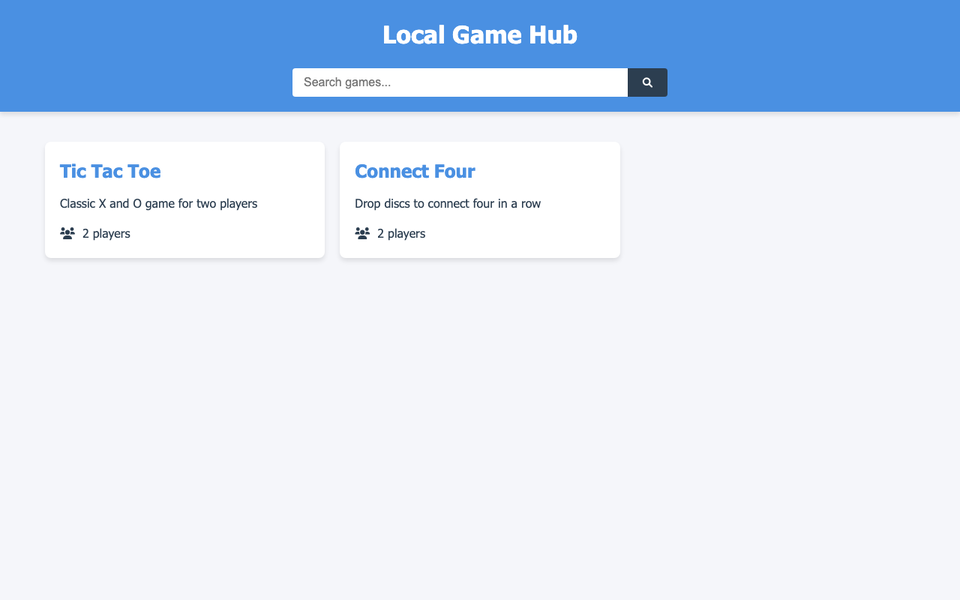

# Simple Game Hub 🎮

A small hub of two-player browser games, with a search bar to find a game.

**Live demo:** https://mccprogrammer.github.io/simple-game-hub/



## Features

- Tic-Tac-Toe: take turns marking a 3×3 grid
- Connect Four: drop discs into a 7×6 grid, four in a row wins
- Search the hub by game name
- Responsive: playable on phones and desktops

## Run it locally

No build step: clone the repo and open `index.html` in a browser.

```bash
git clone https://github.com/MCCProgrammer/simple-game-hub.git
open simple-game-hub/index.html
```

## Built with

HTML, CSS and plain JavaScript.

---

One of my first web projects. More of my work at [mccprogrammer.com/projects](https://mccprogrammer.com/projects).
